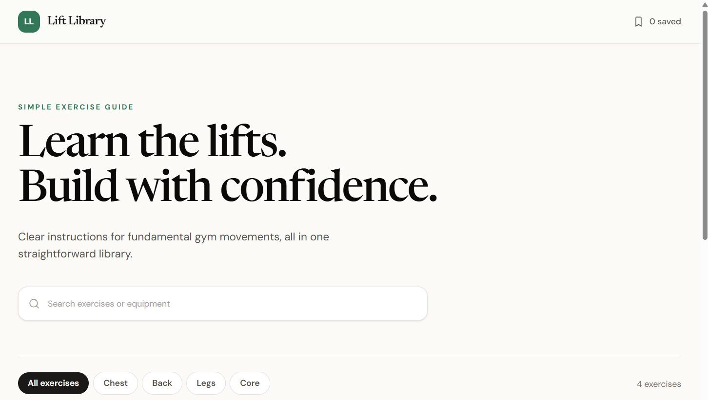
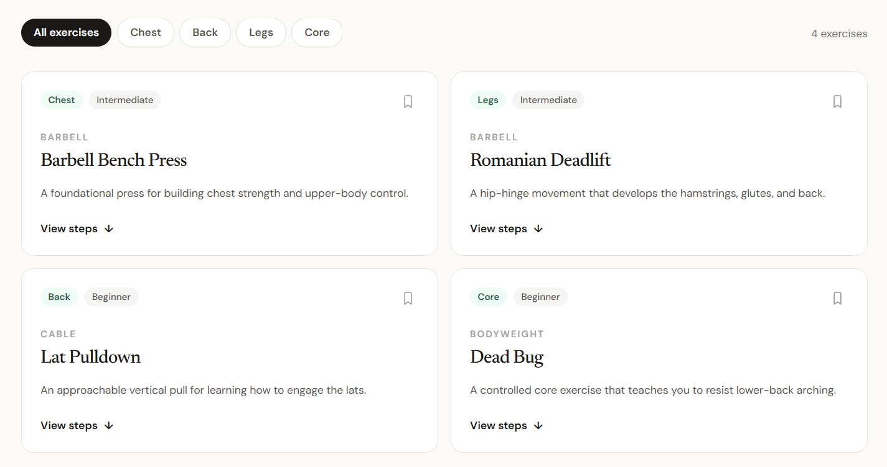

# LiftLibrary

## Om sidan

LiftLibrary är en enkel guide till vanliga övningar på gymmet. Här kan man söka efter övningar, filtrera dem efter muskelgrupp och läsa korta instruktioner.

## Skiss

Jag gjorde skisserna i Figma:

Jag behöll grundidén med en introduktion, sökfält, filter och övningskort. Den färdiga sidan har fler övningar och kategorier än skisserna. Jag använde AI för att prova olika idéer tills sidan kändes mer som den jag hade tänkt mig.

## Funktionalitet

- Man kan söka efter övningar med namn eller beskrivning.
- Man kan filtrera övningarna efter muskelgrupp.
- Man kan spara övningar med stjärnan och visa bara de sparade med bokmärkesknappen.
- Varje kort har en kort beskrivning och numrerade steg.
- Om inget matchar sökningen eller filtret visas ett meddelande.

HTML:en ligger i `index.html`, CSS:en i `style.css` och JavaScript-koden i `script.js`. Funktionen `updateCards()` bestämmer vilka kort som ska visas. Sökfältet, filtren och knapparna använder `addEventListener()` för att reagera på det man gör på sidan.

## AI-användning

Jag fick mycket hjälp av AI med JavaScript eftersom en del av det var överkurs för mig. Jag bad om förklaringar också, så jag lärde mig grunderna och när olika funktioner används.

### Steg för övningarna

- **Vad bad jag om?** Korta steg för övningarna så att besökaren förstår hur de görs.
- **Vad fick jag?** Förslag på numrerade instruktioner med ungefär tre steg per övning.
- **Vad gjorde jag med det?** Jag lade in stegen i korten som numrerade listor och använde CSS för att styla dem.

### Fler övningar

- **Vad bad jag om?** Fler vanliga gymövningar som inte redan fanns på sidan, till exempel hack squat och EZ-bar curl.
- **Vad fick jag?** Förslag på 22 nya övningar med beskrivningar och kategorier.
- **Vad gjorde jag med det?** Jag lade in dem som kort i `index.html` och använde samma kategorier och sparfunktioner som resten av sidan. Jag ville att biblioteket skulle ha fler exempel att välja mellan.

### JavaScript

- **Vad bad jag om?** Hjälp med att göra sökning, filter och sparade övningar interaktiva.
- **Vad fick jag?** Förslag på JavaScript som använder funktioner, DOM-manipulation och `addEventListener()`.
- **Vad gjorde jag med det?** Jag använde förslagen och bad AI förklara hur koden fungerade. Jag lärde mig bland annat hur sidan kan reagera på klick och sökning och sedan uppdatera vilka kort som syns.

### Mobilanpassning

- **Vad bad jag om?** Enkla media queries så att sidan fungerar bättre på mindre skärmar.
- **Vad fick jag?** Regler som ändrar antalet kolumner, låter filtren radbrytas och gör rubriker och sökfält bättre anpassade för mobil.
- **Vad gjorde jag med det?** Jag lade till reglerna i `style.css`. På mindre skärmar visas korten i två kolumner och på mobil i en kolumn.

### Ikoner

- **Vad bad jag om?** Hjälp att lägga till en bokmärkesikon och stjärnikoner.
- **Vad fick jag?** Hjälp med att använda [Material Symbols från Google Fonts](https://fonts.google.com/icons).
- **Vad gjorde jag med det?** Jag lade till länken till ikonerna i HTML:en. Bokmärket används för att visa sparade övningar och stjärnorna för att spara enskilda övningar.

## Tekniska val

- Jag har HTML, CSS och JavaScript i olika filer. Då är det lättare att hitta innehållet, utseendet och funktionerna.

- Varje övning ligger i ett eget `<article>`-element. Attributet `data-category` berättar vilken kategori kortet tillhör.

- Jag använder bland annat `<header>`, `<main>`, `<section>`, `<nav>`, `<article>` och `<footer>` för att göra sidans struktur tydligare.

- Funktionen `updateCards()` sköter sökning, filtrering och visning av sparade övningar på ett ställe.

- Övningsstegen är numrerade eftersom de ska läsas i ordning.

- CSS Grid lägger korten i kolumner och Flexbox placerar andra delar av sidan.

- Media queries ändrar layouten vid olika skärmbredder så att sidan fungerar bättre på surfplatta och mobil.

## Bedömning av AI-innehåll

AI hjälpte mig med övningar, instruktioner, ikoner och kod. Jag valde förslag som passade in i biblioteket och använde samma kategorier och funktioner som de andra korten. Övningarna är exempel i mitt projekt, inte en komplett träningsguide. Jag använde också AI för att förstå JavaScript bättre och lärde mig principerna bakom koden.
